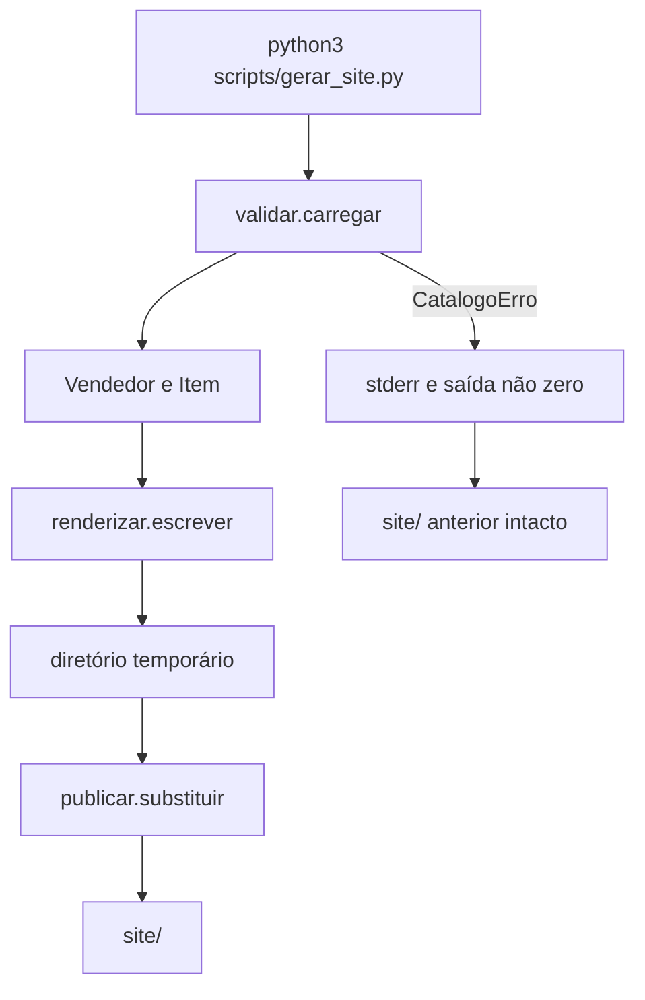
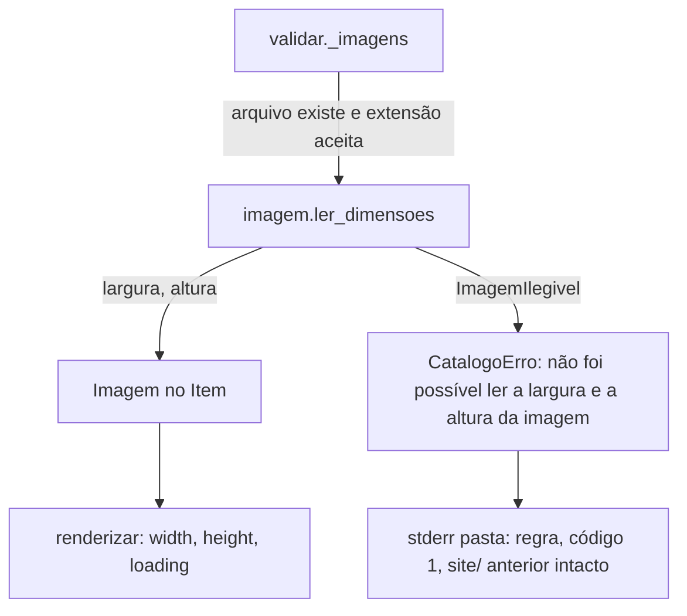

# Vitrine de relógios Design

**Spec**: `.specs/features/vitrine-relogios/spec.md`
**Status**: Approved (emenda de interface: Draft)

---

## Architecture Overview

Um comando Python lê `vendedores/*/vendedor.yaml`, valida o catálogo inteiro e só então grava o HTML. A saída nasce num diretório temporário irmão de `site/`. `site/` só é substituído depois que todos os vendedores passam. O visitante recebe arquivos estáticos: HTML, um CSS, fotos e a fonte Inter. Não há servidor nem framework.



---

## Code Reuse Analysis

### Existing Components to Leverage

| Component | Location | How to Use |
| --- | --- | --- |
| Tokens visuais | `DESIGN.md` | Copiar os hex, a pilha de fonte, a barra de 44px, o raio de 18px e a grade para `gerador/estilos.css`. O gerador não interpreta o Markdown. |
| Fotos do catálogo | `images/catalogo/` | Copiar para `vendedores/alexandre/` quando o YAML real for criado. O gerador só lê a pasta do vendedor. |
| PyYAML 5.4.1 | ambiente local | `yaml.compose` para ver o texto original do escalar. `safe_load` sozinho não serve. |

### Integration Points

| System | Integration Method |
| --- | --- |
| WhatsApp | Link `https://wa.me/<dígitos>?text=` no HTML. Sem API. |
| GitHub Pages | URLs relativas, sem barra inicial. O mesmo `site/` vale na raiz do domínio e em `/<repo>/`. |
| Tema do aparelho | `matchMedia('(prefers-color-scheme: dark)')` só quando `localStorage.tema` não existe. |

O parser de `tmp/pdfs/gerar_catalogo.py` não entra aqui. Ele lê `catalogo.md` e gera PDF. A spec troca a fonte para YAML e apaga esse script.

---

## Components

### Modelo

- **Purpose**: Guardar o catálogo já válido.
- **Location**: `gerador/modelo.py`
- **Interfaces**:
  - `FichaLinha(detalhe: str, especificacao: str)`
  - `Item(id: str, nome: str, valor_pix: float, parcelamento: int, observacoes: str | None, imagens: list[str], ficha: list[FichaLinha])`
  - `Vendedor(pasta: str, nome: str, whatsapp: str, itens: list[Item])`
  - `ORDEM_FICHA: tuple[str, ...]` com os 13 rótulos da spec, nesta ordem
- **Dependencies**: nenhuma
- **Reuses**: nada

### Validar

- **Purpose**: Ler o YAML e recusar o que está fora do formato.
- **Location**: `gerador/validar.py`
- **Interfaces**:
  - `CatalogoErro(pasta: str, regra: str)` levanta com a pasta e a regra
  - `carregar(raiz: Path) -> list[Vendedor]` lê `raiz/vendedores/*/vendedor.yaml`, ordena por `nome.casefold()` e, no empate, pelo nome da pasta
- **Dependencies**: PyYAML, Modelo
- **Reuses**: nada

`carregar` percorre só diretórios imediatos de `vendedores/`. Zero pastas é catálogo válido e gera a raiz vazia. Pasta sem `vendedor.yaml` falha.

A leitura usa `yaml.compose` e confere o texto do escalar, não só o valor Python. No PyYAML 5.4.1, `yes` vira `bool` e `12:00` vira o inteiro `720`. Por isso:

- `whatsapp` precisa do texto `^[0-9]{12,15}$`. Número sem aspas passa se o texto for só dígitos nesse tamanho. `bool` falha.
- `parcelamento` precisa do texto `^[0-9]+$` e do valor inteiro maior ou igual a 1. `12.0` e `12:00` falham.
- `valorPix` precisa do texto `^[0-9]+(\.[0-9]+)?$` e do valor numérico maior que zero. `bool` falha.
- `nome` do vendedor e do item é string não vazia.
- Chaves fora do formato, rótulo fora da lista, rótulo repetido, ficha vazia, valor de ficha em branco, `id` repetido no vendedor, pasta ou `id` fora de `^[a-z0-9]+(-[a-z0-9]+)*$`, imagem com barra, arquivo ausente e extensão fora de png, jpg, jpeg, webp e avif falham.
- `observacoes` ausente vira `None`. String só com espaços vira `None`.

### Renderizar

- **Purpose**: Escrever o HTML, o CSS, a fonte e as fotos a partir do modelo válido.
- **Location**: `gerador/renderizar.py`, `gerador/estilos.css`, `gerador/tema.js`, `gerador/carrossel.js`
- **Interfaces**:
  - `escrever(vendedores: list[Vendedor], destino: Path, fontes: Path) -> None`
  - `formatar_preco(valor: float) -> str` devolve `R$ 369,90 no Pix` e `R$ 1.234,50 no Pix`
  - `formatar_parcelamento(vezes: int) -> str` devolve `em até 12x com acréscimo`
  - `link_whatsapp(digitos: str, nome_modelo: str) -> str`
- **Dependencies**: Modelo
- **Reuses**: o texto de `estilos.css`, `tema.js` e `carrossel.js`

`escrever` cria:

```
destino/index.html
destino/<pasta>/index.html
destino/<pasta>/<id>/index.html
destino/<pasta>/imagens/<arquivo>
destino/estilos.css
destino/fontes/InterVariable.woff2
```

Todo texto visível passa por `html.escape`. Links internos são relativos ao arquivo: `alexandre/` na raiz, `../` da vitrine para a raiz, `../` do relógio para a vitrine, `../../` do relógio para a raiz.

O `<head>` começa com `tema.js` inline, antes do `<link>` do CSS. O script lê `localStorage.tema`. Sem valor, usa o esquema do aparelho. Grava `data-tema` em `<html>` como `claro` ou `escuro`. O controle na barra preta mostra o modo oposto: `Escuro` no claro e `Claro` no escuro. O clique troca o atributo e a chave `tema`.

A barra preta tem 44px e fundo `#000000` nos dois modos. O texto é `Catálogo`. Não há busca nem sacola. Vitrine e relógio ganham uma segunda barra com o nome do vendedor. O rodapé tem só `Catálogo de relógios`.

A vitrine usa uma coluna até 640px, duas de 641px a 834px, três de 835px a 1068px, quatro de 1069px a 1440px e cinco a partir de 1441px. O card é um único link, com raio de 18px. A foto preenche um quadro quadrado em `object-fit: cover`, centrada, com raio de 8px. Sem itens, o texto é exatamente `Esta vitrine ainda não tem relógios.`

O relógio segue a ordem da spec. A ficha sai na ordem de `ORDEM_FICHA`, rótulo em cima e valor embaixo, sem a linha que faltar. `Link de anúncio similar` vira link com o texto `Ver anúncio similar` só quando o valor, sem espaços nas pontas, casa `^https?://\S+$`. `observacoes` com texto entra sozinho, sem título.

O carrossel mostra uma foto por vez, na largura do conteúdo, num quadro quadrado em `object-fit: cover`, sem raio. Com uma foto não há seta nem bolinha. Com duas ou mais, há setas de 44px e uma bolinha-botão por foto. A próxima depois da última volta para a primeira. O deslize usa ponteiro. `carrossel.js` entra inline só na página do relógio. `og:title` é o nome do modelo. `og:image` é a URL relativa da primeira foto.

A barra fixa repete o preço e a pílula `Tenho interesse` (`#0066cc`, texto branco). No escuro, o fundo da página é `#272729`, o card `#2a2a2c`, o texto `#ffffff`, o texto secundário `#cccccc` e o link `#2997ff`. O rodapé usa `#272729` sólido com texto branco. Segunda barra e barra fixa usam `rgba(39, 39, 41, 0.8)` com `saturate(180%) blur(20px)`. A foto não ganha filtro. No claro, o rodapé é `#f5f5f7`. Nenhum hex do CSS fica fora de `DESIGN.md`.

A pilha de fonte é `system-ui, -apple-system, BlinkMacSystemFont, "Inter", sans-serif`. Inter vem de `fontes/InterVariable.woff2`, copiado para `site/fontes/`. A geração não baixa nada.

### Publicar

- **Purpose**: Trocar `site/` só depois do sucesso completo.
- **Location**: `gerador/publicar.py` e `scripts/gerar_site.py`
- **Interfaces**:
  - `substituir(raiz: Path) -> None` valida, renderiza e troca a pasta
  - `scripts/gerar_site.py` chama `substituir` com a raiz do repositório. Em `CatalogoErro`, escreve `pasta: regra` no stderr e sai com código 1
- **Dependencies**: Validar, Renderizar
- **Reuses**: nada

A troca é esta:

1. Validar tudo. Se falhar, não criar arquivo novo. Se `site/` não existe, continuar sem ele.
2. Renderizar em `site.novo.<pid>/` ao lado de `site/`.
3. Se `site/` existe, renomear para `site.anterior.<pid>/`.
4. Renomear `site.novo.<pid>/` para `site/`.
5. Apagar `site.anterior.<pid>/`.

Se o passo 4 falha, o passo 3 é desfeito e o temporário novo é apagado. Duas execuções com a mesma entrada produzem o mesmo HTML.

---

## Data Models

### Vendedor

```python
class Vendedor:
    pasta: str
    nome: str
    whatsapp: str
    itens: list[Item]
```

**Relationships**: uma pasta, um YAML, zero ou mais itens. O mesmo bloco de item em outra pasta é outra cópia, sem id compartilhado.

### Item

```python
class Item:
    id: str
    nome: str
    valor_pix: float
    parcelamento: int
    observacoes: str | None
    imagens: list[Imagem]
    ficha: list[FichaLinha]
```

**Relationships**: as imagens são arquivos na pasta do vendedor. `Imagem` está na seção da emenda de interface. A ficha não guarda a ordem do YAML. A página usa `ORDEM_FICHA`.

---

## Error Handling Strategy

| Error Scenario | Handling | User Impact |
| --- | --- | --- |
| YAML inválido ou campo fora do formato | `CatalogoErro` com pasta e regra. Stderr `pasta: regra`. Código 1. `site/` não muda. | O visitante continua no site anterior. Quem gera lê a regra. |
| `site/` ainda não existe e a geração falha | Nenhum `site/` é criado. | Não há site parcial. |
| Falha no meio da troca de pastas | Restaura `site.anterior.<pid>/` para `site/` e apaga o temporário novo. | O site anterior volta. |
| Foto ausente ou extensão recusada | A mesma falha de validação, antes de escrever HTML. | Nada é publicado. |
| Catálogo sem vendedores | Publica a raiz sem nomes. | A lista abre vazia. |

---

## Risks & Concerns

| Concern | Location (file:line) | Impact | Mitigation |
| ------- | -------------------- | ------ | ---------- |
| PyYAML 5.4.1 resolve `yes` como bool e `12:00` como 720 | ambiente, PyYAML 5.4.1, conferido com `yaml.safe_load` | Um parcelamento inválido passaria como inteiro | Validar o texto do escalar com `yaml.compose`, não o valor já convertido |
| O parser do PDF lê Markdown e contradiz a spec | `tmp/pdfs/gerar_catalogo.py:14` e `PLANO.md:16` | Reusar esse código publicaria a fonte errada | Não importar esse módulo. A tarefa do catálogo apaga `tmp/`, `PLANO.md` e o PDF |
| `os.replace` não troca diretório de forma atômica | `gerador/publicar.py` ainda não existe | Uma queda no meio da troca pode esconder `site/` | Renomear o antigo para fora, publicar o novo e só então apagar o antigo. Se o novo não entra, restaurar o antigo |
| Não há testes no repositório | raiz do projeto | A geração pode quebrar sem sinal | A suíte unittest cobre o catálogo de exemplo e cada falha da spec, sem ler o YAML real |
| `og:image` relativo não previewa no WhatsApp até haver URL pública | spec, prévia | A prévia depende do domínio publicado | A spec escolheu URL relativa. O teste confere o caminho da primeira foto, não um domínio |
| A fonte Inter ainda não está no repositório | `fontes/` ausente | Sem o arquivo, a geração não cumpre a pilha de fonte | A tarefa de tema versiona `fontes/InterVariable.woff2` da release oficial. A geração só copia |

---

## Tech Decisions

| Decision | Choice | Rationale |
| --- | --- | --- |
| Linguagem do gerador | Python 3 + PyYAML | Confirmado. Registrado em AD-001. |
| Testes | `unittest` da biblioteca padrão | A suíte não ganha dependência além do PyYAML, que o gerador já usa. |
| Leitura do YAML | `yaml.compose` e texto do escalar | O valor Python do PyYAML 5.4.1 aceitaria entrada inválida. |
| HTML | Strings e `html.escape` | O formato das páginas é fixo. Motor de template seria outra dependência. |
| Tema e carrossel | JavaScript inline, sem biblioteca | O tema precisa rodar antes da pintura. O carrossel só avança índice. |
| Inter | `fontes/InterVariable.woff2` versionado | A geração não acessa rede. |
| CSS | Um arquivo `gerador/estilos.css` copiado para `site/` | Os tokens ficam num lugar só e o teste lê os hex. |

---

## Emenda de interface

**Origem**: `PLANO-INTERFACE.md`. Requisitos `VITR-48`, `VITR-49`, `VITR-64` alterados e `VITR-74` a `VITR-108` novos.

A largura e a altura de cada foto são lidas uma vez, na validação, e viajam no modelo até o HTML. O renderizador continua sem ler disco além de copiar CSS e fonte. Uma imagem ilegível é mais uma regra de `CatalogoErro`, então herda o caminho que já preserva o `site/` anterior e já escreve `pasta: regra` no stderr.



### Code Reuse

| Component | Location | How to Use |
| --- | --- | --- |
| `CatalogoErro` e a troca de `site/` | `gerador/validar.py:46`, `gerador/publicar.py:10` | A regra nova levanta `CatalogoErro`. Publicação e CLI não mudam. |
| Anel de foco | `gerador/estilos.css:287` | Acrescentar link de pular, bolinha e seta à mesma regra `:focus-visible`. |
| Vidro claro da segunda barra | `gerador/estilos.css:296` | Mesmo `backdrop-filter`, com fundo `rgba(39, 39, 41, 0.8)` no escuro. |
| `irPara` do carrossel | `gerador/carrossel.js:46` | O clique na bolinha chama `irPara(i)`. `atualizarBolinhas` já mantém `aria-current`. |
| `atualizarControle` do tema | `gerador/tema.js:24` | Grava também o `aria-label` do modo atual. |
| Harness Node de tema e carrossel | `tests/test_tema.py`, `tests/test_carrossel.py` | Os mocks ganham `setAttribute` no controle e `addEventListener`/`click` na bolinha. |

### Imagem

- **Purpose**: Ler largura e altura do cabeçalho de PNG, JPEG, WebP e AVIF, já com a orientação aplicada.
- **Location**: `gerador/imagem.py`
- **Interfaces**:
  - `class ImagemIlegivel(Exception)`
  - `ler_dimensoes(caminho: Path) -> tuple[int, int]` devolve `(largura, altura)` ou levanta `ImagemIlegivel`
- **Dependencies**: só a biblioteca padrão (`struct`, `pathlib`)
- **Reuses**: nada

O formato sai da assinatura dos bytes:

| Formato | Assinatura | Tamanho | Orientação |
| --- | --- | --- | --- |
| PNG | `89 50 4E 47 0D 0A 1A 0A` e o primeiro bloco `IHDR` | `>II` nos bytes 16 a 24 | não tem |
| JPEG | `FF D8` | Percorre segmentos `FF xx` + tamanho `>H`. O primeiro SOF (`C0`–`CF`, exceto `C4`, `C8`, `CC`) traz `>BHH`: precisão, altura, largura | APP1 que começa com `Exif\0\0`: TIFF `II` ou `MM`, IFD0, tag `0x0112` |
| WebP | `RIFF` + 4 bytes + `WEBP` | `VP8 `: código `9D 01 2A` no byte 3 do bloco, largura e altura `<HH` & `0x3FFF`. `VP8L`: byte `0x2F`, depois 32 bits `<I`, largura = bits 0–13 + 1, altura = bits 14–27 + 1. `VP8X`: bytes 4–6 e 7–9, 24 bits `<` + 1 | Bloco `EXIF` dentro de `VP8X`. Aceita o TIFF com ou sem o prefixo `Exif\0\0` |
| AVIF | caixa `ftyp` com marca `avif` ou `avis` | Caixas ISO BMFF (`>I` tamanho + tipo, `1` = tamanho de 64 bits, `0` = até o fim). `meta` → `pitm` (item primário) e `iprp` → `ipco` + `ipma`. O `ispe` (`>II` depois de versão e flags) associado ao item primário | `irot` associado ao item primário: ângulo = byte & 3. `1` ou `3` troca |

Exif 5, 6, 7 e 8 trocam largura e altura. 1 a 4 e a ausência mantêm. Exif truncado ou malformado é tratado como ausente; o tamanho do SOF continua válido. Arquivo truncado antes do tamanho, assinatura desconhecida, `ispe` ausente no item primário, largura ou altura zero levantam `ImagemIlegivel`.

### Validar (mudança)

`_imagens` mantém a ordem atual das regras: lista vazia, barra, extensão, arquivo ausente. Depois chama `ler_dimensoes(pasta_dir / nome)`. `ImagemIlegivel` vira `CatalogoErro(pasta, REGRA_TAMANHO_IMAGEM)` com `REGRA_TAMANHO_IMAGEM = "não foi possível ler a largura e a altura da imagem"`. A mensagem não cita o arquivo. O item passa a carregar `Imagem(arquivo, largura, altura)`.

### Renderizar (mudança)

- `_pagina`: `<meta name="viewport" content="width=device-width, initial-scale=1">` logo depois de `charset`. Primeiro filho do `body`: `<a class="pular" href="#conteudo">Pular para o conteúdo</a>`. `<main id="conteudo" tabindex="-1">`.
- `_card(item, primeiro: bool)`: `width` e `height` da primeira `Imagem`. `loading="lazy"` quando não é o primeiro card.
- `_carrossel`: cada foto com `width` e `height`. `loading="lazy"` a partir da segunda. Cada bolinha é `<button type="button" class="bolinha" aria-label="Foto N">`, a primeira com `aria-current="true"`.
- `og:image` e `src` usam `Imagem.arquivo`. `publicar._copiar_imagens` também.

### Carrossel (mudança)

`prepararCarrossel` registra `click` em cada bolinha, chamando `irPara(i)`. Não há outra mudança de estado.

### Tema (mudança)

`atualizarControle(controle, tema)` grava `textContent` e `aria-label`: `Modo claro. Mudar para escuro.` no claro e `Modo escuro. Mudar para claro.` no escuro. O clique já passa por `atualizarControle`.

### Estilos (mudança)

| Área | Regra |
| --- | --- |
| Foto do card | `aspect-ratio: 1 / 1`, `width: 100%`, `height: auto`, `object-fit: cover`, `object-position: center`, `border-radius: 8px`. O card fica com 18px. |
| Foto do carrossel | Mesmo quadro, `border-radius: 0`. A altura do carrossel passa a ser a do quadro, igual para todas as fotos. |
| Escuro | `html[data-tema="escuro"] { color-scheme: dark; }`. Segunda barra e barra fixa: `rgba(39, 39, 41, 0.8)` + `saturate(180%) blur(20px)`. Rodapé: `#272729`. Borda do card, `.ficha-linha` e separador de `.lista-vendedores a`: `rgba(255, 255, 255, 0.16)`. |
| Botão de tema | `border: 1px solid rgba(255, 255, 255, 0.16)` e fundo `#1d1d1f`. |
| Link de pular | Fora do foco: `position: fixed; top: 8px; left: 8px; transform: translateY(-200%)`. Com `:focus`: `transform: none`, fundo `#0066cc`, texto `#ffffff`, raio `9999px`, `z-index: 30`, acima dos 20 da barra preta. |
| `scroll-padding` | `html { scroll-padding-top: 44px; }`, `html:has(.barra-vendedor) { scroll-padding-top: 96px; }`, `html:has(.barra-fixa) { scroll-padding-bottom: 64px; }`. |
| Foco | `.pular`, `.bolinha` e `.seta` entram na regra `:focus-visible` existente. |
| Bolinha | Botão de 44×44px, sem borda e sem fundo. O ponto de 8px é um `::before`. `.bolinhas { gap: 8px }`. A cor ativa continua em `[aria-current="true"]::before`. |
| Contraste | `.parcelamento` e `dt` passam a `#333333`. `#7a7a7a` sai do arquivo. |
| Movimento | `@media (prefers-reduced-motion: reduce)`: os três `:active` com `transform: none`. |
| Tipografia | `.preco { font-variant-numeric: tabular-nums }`. `h1`, `.nome-vendedor`, `.card .nome { text-wrap: balance }`. `.card .nome { overflow-wrap: anywhere }`. A coluna única da grade passa a `minmax(0, 1fr)`. |

### Data Model

```python
@dataclass
class Imagem:
    arquivo: str
    largura: int
    altura: int
```

`Item.imagens: list[Imagem]`. A fixture `tests/catalogo_exemplo.py` monta `Imagem("primeiro.png", 400, 400)`. Os testes de validação e publicação gravam um PNG mínimo (assinatura + `IHDR`) no lugar de `b"img"`. Um ajudante de teste, `tests/imagens_exemplo.py`, monta cabeçalhos mínimos de PNG, JPEG (com e sem Exif), WebP (`VP8 `, `VP8L`, `VP8X` com `EXIF`) e AVIF (`ftyp`, `meta`, `pitm`, `iprp`, `ispe`, `irot`). Os bytes só precisam do cabeçalho; não precisam abrir num visualizador.

### Error Handling

| Error Scenario | Handling | User Impact |
| --- | --- | --- |
| Cabeçalho ilegível, truncado ou de formato desconhecido | `CatalogoErro(pasta, "não foi possível ler a largura e a altura da imagem")`. Stderr `pasta: regra`, código 1. | O `site/` anterior fica. A mensagem não cita o arquivo, como manda o plano. |
| Largura ou altura zero | O mesmo erro. | Idem. |
| Exif malformado com SOF válido | Ignora a orientação e usa o SOF. | A foto publica com o tamanho do cabeçalho. |

### Risks & Concerns

| Concern | Location (file:line) | Impact | Mitigation |
| --- | --- | --- | --- |
| A fixture e dois testes usam bytes falsos de imagem | `tests/test_validar.py:54`, `tests/test_publicar.py:16` | Com a leitura de cabeçalho, `b"img"` passa a falhar | A tarefa da validação troca por um PNG mínimo do ajudante de teste. |
| Os testes de estilo afirmam o comportamento antigo | `tests/test_estilos.py`, raio 18px na foto, `contain`, `#272729` nas três superfícies | O gate falha até o teste mudar | Cada tarefa de CSS reescreve o teste do critério que muda, a partir da spec. |
| O leitor de CSS dos testes pode não entender `@media (prefers-reduced-motion)` e `:has()` | `tests/test_estilos.py:47` | Asserção falsa ou exceção | A tarefa que precisar estende o leitor e testa o leitor com um caso pequeno. |
| AVIF com várias `ispe` (miniatura, alfa) | formato ISO BMFF | Ler a primeira `ispe` daria o tamanho errado | Seguir `pitm` → `ipma` → índice em `ipco`. |
| `:has()` em navegador antigo | `scroll-padding` com segunda barra | Sem suporte, o respiro de 44px vale também onde há segunda barra | O CSS já usa `main:has(...)`. O risco é aceito. |

### Tech Decisions

| Decision | Choice | Rationale |
| --- | --- | --- |
| Onde ler o tamanho | Na validação, guardado em `Imagem` | Falha cedo pelo caminho de `CatalogoErro`. O renderizador continua puro. Escolha do dono. |
| Leitor de cabeçalho | `struct` da biblioteca padrão | O plano proíbe pacote novo. AD-001 continua valendo. |
| Formato | Pela assinatura | Uma extensão errada não engana o leitor. |
| Bolinha | `button` de 44px com `::before` de 8px | Alvo de toque sem mudar o desenho do ponto. |
| Nome acessível do tema | `aria-label` gravado por `atualizarControle` | Um só lugar atualiza rótulo e nome. |
